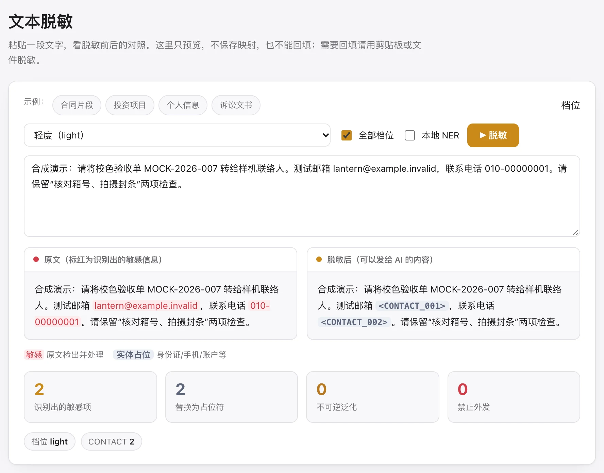
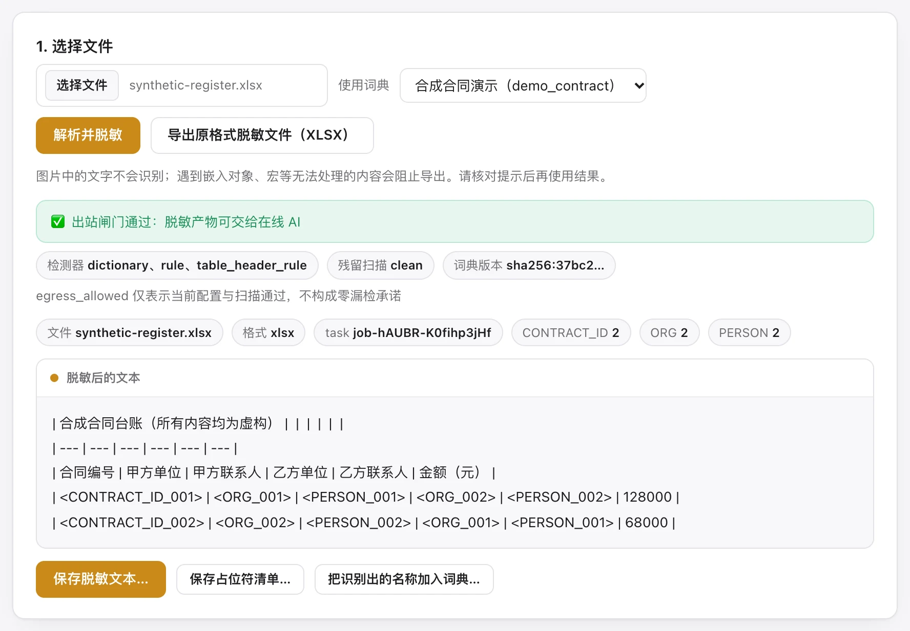
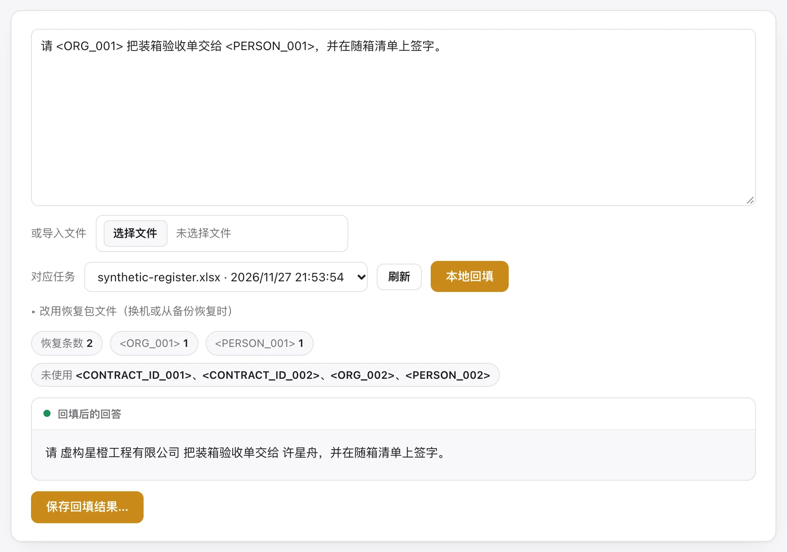
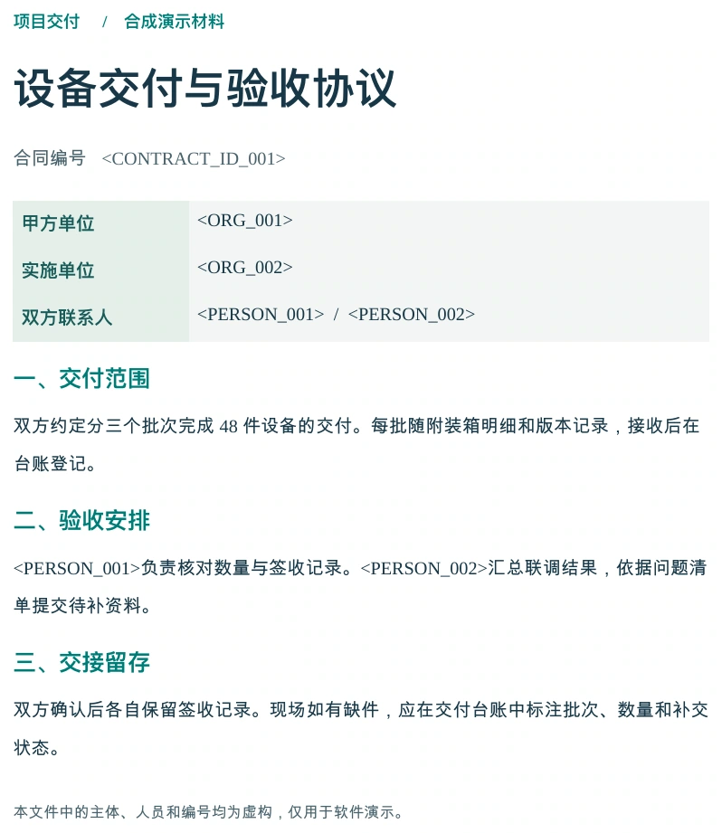
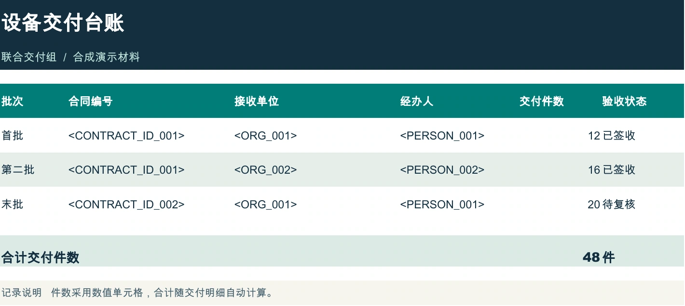
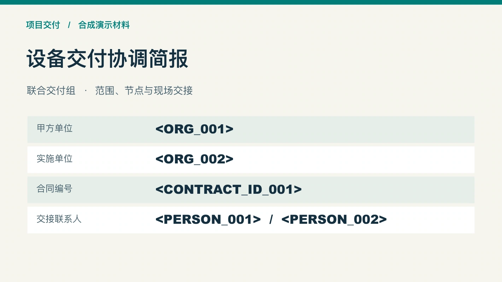
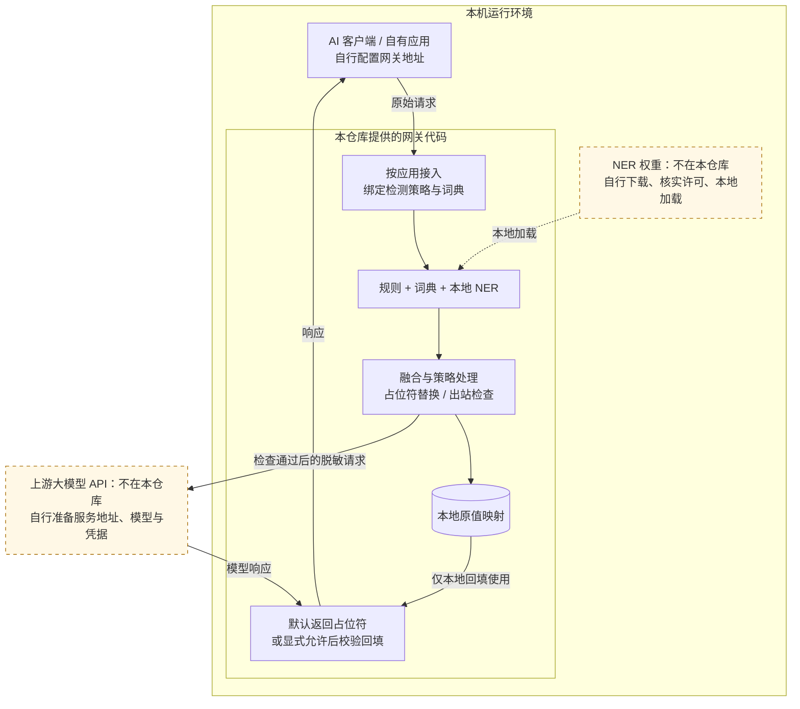

# Tuomin 脱敏网关与桌面工作台

Tuomin 帮你在本机把文档里的联系人、组织名称、合同号等敏感值替换成占位符。将经过核对的内容交给 AI，拿到回答后再用同一份本地映射恢复原值。你可以从 macOS 菜单栏或 Windows 托盘处理剪贴板，也可以批量处理 Office 文件，或把客户端接到本地网关。

**[macOS Apple Silicon · DMG](https://github.com/Doubixilin/tuomin-open-source/releases/download/v0.2.0/Tuomin-0.2.0-macOS-arm64-Lite.dmg) · [Windows x64 · ZIP](https://github.com/Doubixilin/tuomin-open-source/releases/download/v0.2.0/Tuomin-0.2.0-Windows-x64-Lite.zip) · [Office 和剪贴板演示包](https://github.com/Doubixilin/tuomin-open-source/releases/download/v0.2.0/Tuomin-0.2.0-Demo.zip)**

macOS 13 起可用，打开 DMG 后将 Tuomin Lite 拖入「应用程序」。Mac 包采用本机临时签名，未经 Apple 公证。Windows 完整解压后运行 `Tuomin.exe`，窗口使用系统 WebView2。两个 Lite 构建都使用规则和本机词典，未登记的人名、机构请人工核对。[版本说明与 SHA-256](https://github.com/Doubixilin/tuomin-open-source/releases/tag/v0.2.0) · [按图上手](docs/DESKTOP_GUIDE.md) · [在线查看 Office 对照](demo/office-showcase/README.md)



### 选一个任务开始

| 手头的任务 | 从哪里开始 | 怎么核对 |
| --- | --- | --- |
| 复制一段内容给 AI | 复制原文，手动触发「脱敏剪贴板」，再粘贴给 AI | 在 Tuomin 查看占位符，把 AI 回答复制回来后触发「回填剪贴板」。[剪贴板操作](docs/DESKTOP_GUIDE.md#剪贴板) |
| 交付一份 Word、Excel 或 PowerPoint | 打开「文件脱敏」，选择词典和文件，按需导出原格式副本 | 下载同一份合成材料的原件、脱敏件、回填件，检查表格、排版和占位符。[Office 演示](demo/office-showcase/README.md) |
| 想知道某个名字会不会被识别 | 打开「文本脱敏」，粘贴文字、选档位、执行预览 | 对照原文和占位符，检查漏掉的敏感值，也检查是否意外删除了条款。[操作图解](docs/DESKTOP_GUIDE.md#文本预览) |
| 想让已有 AI 工具接入 | 打开「工具接入」，选择 MCP 或支持自定义地址的兼容客户端 | 先自检，再到客户端确认实际生效的工具或网关地址。[网关说明](docs/GATEWAY.md) |

**剪贴板怎么用。** 复制原文后按 macOS `⌥⌘D` 或 Windows `Ctrl+Alt+D`，Tuomin 才会读取并将成功的脱敏结果写回剪贴板。手动粘贴给 AI。复制 AI 回答后按 `⌥⌘R` 或 `Ctrl+Alt+R`，再把恢复结果粘回本地文档。普通动作遇到阻断、未知占位符或剪贴板已变化时会保留当时的内容。要自动粘贴，需另外启用「选中脱敏并替换」或「选中回填并替换」。[剪贴板操作与实拍](docs/DESKTOP_GUIDE.md#剪贴板)

**工作中的界面**

| 处理 Excel 台账 | 用任务映射回填一段回答 |
| --- | --- |
| [](docs/manual/img/walkthrough-spreadsheet.webp) | [](docs/manual/img/walkthrough-answer.webp) |

### Office 原格式脱敏效果

以下是实际生成的合成脱敏件。点击图打开大图，检查版式和占位符；对照包同时提供可编辑的原件和回填件。

| Word 条款 | Excel 台账 | PowerPoint 项目简报 |
| --- | --- | --- |
| [](demo/office-showcase/images/service-agreement-redacted.webp) | [](demo/office-showcase/images/delivery-register-redacted.webp) | [](demo/office-showcase/images/project-brief-redacted.webp) |

[下载原件、脱敏件、回填件与流程演示 PPT](demo/office-showcase/README.md)

## 从源码运行桌面工作台

从仓库根目录创建并激活 Python 虚拟环境。桌面回归使用 Python 3.12.10，Node 测试使用 22.23.1。安装依赖后，以下命令启动合成演示。

```bash
python -m pip install ".[serve,shell,document]"
python packaging/launcher.py --demo
```

演示会在临时目录创建合成词典、应用配置与 Office 文件。正常运行使用 `python packaging/launcher.py`。需要原生窗口时，macOS 使用系统 WebKit，Windows 使用 WebView2。从源码处理 PDF 原生文本可安装 `.[pdf-text]`（pdfminer.six）。公开 Lite 桌面包包含这条文本解析路径。Lite 使用规则与选定词典，未登记的姓名或公司可能留下；启用本地 NER 的源码部署需另备权重。[外部资源说明](docs/EXTERNAL_RESOURCES.md)

## 作为本地 AI 网关使用

支持自定义 API 地址的应用，可以将兼容请求先交给本机脱敏网关：本地规则、词典和 NER 共同检测，按应用策略替换敏感值，再转发到配置好的上游模型服务。原值映射留在本地；响应默认保留占位符，也可为受信任的本地应用显式启用自动回填。



图示为准备好 NER 后的网关能力；本仓库提供加载代码，不包含权重。上游身份验证凭据仍需传给对应服务，不能把“文本脱敏”理解为所有请求字段都被隐藏。未通过必要检测或出站检查的请求会被阻断；检测覆盖本身不等于零漏检。

例如，OpenAI Chat Completions 兼容客户端可将 Base URL 设为 `http://127.0.0.1:8765/apps/gateway_demo/v1`。该地址需先注册应用、配置上游并准备本地检测器；当前不是通用协议转换器，也不自动代理应用的其他网络请求。

详细配置、两种响应模式和接口边界见 [网关接入说明](docs/GATEWAY.md)。

## 用图理解完整设计

这些图描述公开源码已经实现的处理路径，并把额外依赖、配置条件和失败分支一起画出。完整 NER 路径需要另行准备权重；图示不是本次已经完成模型联调或准确率验证的证明。

| 想了解什么 | 图文入口 |
| --- | --- |
| 日常怎样识别、脱敏、回填和导出 | [桌面工作台图文指南](docs/DESKTOP_GUIDE.md) |
| 为什么采用本地脱敏与可信回填、有哪些功能 | [设计思路、数据边界和功能总览](docs/DESIGN.md) |
| 各层怎样协作，规则、词典、NER 如何融合 | [技术架构、检测流水线和 NER 实现](docs/ARCHITECTURE.md) |
| 文本、文件、回答和长期上下文分别怎样处理 | [工作流程、回填决策和映射生命周期](docs/WORKFLOWS.md) |
| 客户端怎样配置网关，请求和响应怎样转发 | [网关配置关系和请求时序](docs/GATEWAY.md) |

## 先跑通一个不依赖模型的示例

需要 Python 3.10 或更新版本。首次安装需要获取普通 Python 依赖；安装完成后，示例运行不联网。

```bash
git clone https://github.com/Doubixilin/tuomin-open-source.git
cd tuomin-open-source
python -m venv .venv
```

macOS / Linux 激活环境：`source .venv/bin/activate`；Windows PowerShell：`.venv\Scripts\Activate.ps1`。

```bash
python -m pip install .
python examples/minimal_demo.py
```

示例只处理代码内明确标注的合成文本，展示“规则＋词典识别 → 占位符脱敏 → 本地回填 → 拒绝未知占位符”。映射只放在进程内存中，不落盘，不读取你的文档或配置，不访问钥匙串，不加载 NER 模型。成功时会输出 `示例验证通过`。

这个例子验证的是**流程和占位符完整性**。它无法据此证明：任意姓名都能被识别、真实合同没有漏检、图片已脱敏、文件内嵌对象已处理，或者发给模型的文本一定安全。规则只能识别覆盖到的格式，词典只能识别已声明的实体。

## 公开版包含什么

| 能力 | 状态和前提 |
| --- | --- |
| 规则检测、词典匹配、重叠合并、脱敏与严格回填 | 最小示例可直接研究，无模型 |
| 会话稳定占位符、命名空间、审计、映射保护、权限控制 | 提供实现与合成测试；部署前按场景配置 |
| 本地 HTTP API 与 Web 控制台 | 安装 `.[serve]` 并准备应用配置 |
| TXT、Word、Excel、PowerPoint | DOCX、XLSX、PPTX 支持生成原格式副本与回填件。源码处理表格需安装 `.[document]`。旧格式转换取决于本机工具。 |
| PDF 原生文字提取 | Lite 使用 pdfminer.six，处理已有文字层。扫描页和图片需要另行核查。 |
| 本地中文 NER | 仅提供接入代码；模型权重不随仓库提供，需自行核实许可和准备 |
| MCP、模型代理、外部应用适配 | 提供代码供研究，须自行配置服务地址、Token、上游和应用策略；最小示例不会启用 |
| macOS / Windows 桌面工作台 | 含托盘或菜单栏、剪贴板、选区、热键、演示及两端构建脚本 |

## 可选：本地服务

```bash
python -m pip install '.[serve,document]'
```

将 `tuomin_apps.example.json` 复制为 `tuomin_apps.json`，然后：

```bash
tuomin-gateway serve --host 127.0.0.1 --port 8765
```

访问启动日志给出的 `/ui/` 地址。日志会说明管理 Token 文件的位置；不要把 Token 提交到仓库。管理 Token 是访问控制凭据，与 MIT 许可证、可选激活机制不是一回事。社区源码正常运行无需激活。

示例配置中的 `research_demo` 明确关闭 NER，只适合合成流程演示。界面里的其他预设可能要求 NER；未准备模型时应查看 `/readiness` 和降级／阻断提示，不要为了通过检查而关闭真实业务需要的检测器。当前全局 `/readiness` 还会检查未注册请求的 strict 默认策略，因此无模型时返回 503 是预期行为，即使显式配置的无模型合成应用仍能运行。`/healthz` 仅表示进程存活。

macOS 服务映射默认使用钥匙串支持的加密，Windows 使用 DPAPI；Linux 当前存在明文开发存储路径，不能宣称三端都默认加密。离线 CLI 导出的映射也是含原值的明文文件。不要上传映射、原始输入或恢复材料。详见 [安全边界](docs/BOUNDARIES.md)。

## 阅读路线与外部资源

- [设计思路、功能总览与数据边界](docs/DESIGN.md)
- [技术架构与代码入口](docs/ARCHITECTURE.md)
- [文本、文件、回填与映射工作流程](docs/WORKFLOWS.md)
- [作为本地 AI 网关使用：配置与请求流程](docs/GATEWAY.md)
- [模型与第三方资源索引、准备方法](docs/EXTERNAL_RESOURCES.md)
- [能力范围和安全边界](docs/BOUNDARIES.md)
- [第三方许可说明](THIRD_PARTY_NOTICES.md)
- [贡献与后续更新](CONTRIBUTING.md)
- [版本记录](CHANGELOG.md)

公开样例不包含实际业务材料。回归测试中使用的姓名、号码和组织字符串仅用于构造检测场景，不用于联系或识别现实中的个人；不要用演示词典代替自己的受控业务词典。

可运行 `python docs/competition/eval/evaluate_synthetic_contract_tuomin.py --mode rules-dictionary` 复现合成合同评测。三个场景覆盖工作范围、通知交接和现场验收；结果分别统计敏感项的移除和原有业务信息的保留。

## 测试

```bash
python -m pip install ".[dev]"
python -m pytest -q
npm test
```

测试使用临时目录和合成数据，不要求下载模型。安装 `.[pdf-text]` 可验证公开构建的 PDF 读取路径，安装 `.[pdf]` 可额外验证 PyMuPDF 后端。平台专属测试在不适用的平台跳过。双平台验证范围见 [验证记录](docs/VALIDATION.md)。

## 许可证

本仓库中由作者拥有权利的代码和文档采用 [MIT](LICENSE)。第三方依赖、模型和数据适用各自条款；本项目的 MIT 不会替它们重新授权。尤其 PyMuPDF 的组合使用／分发须另行满足 AGPL 或有效商业授权条件，见 [第三方许可说明](THIRD_PARTY_NOTICES.md)。

你可以研究、修改和复用代码。请不要把它描述为“零泄漏”“所有文件均可安全上传”或已经完成生产安全认证的产品。
