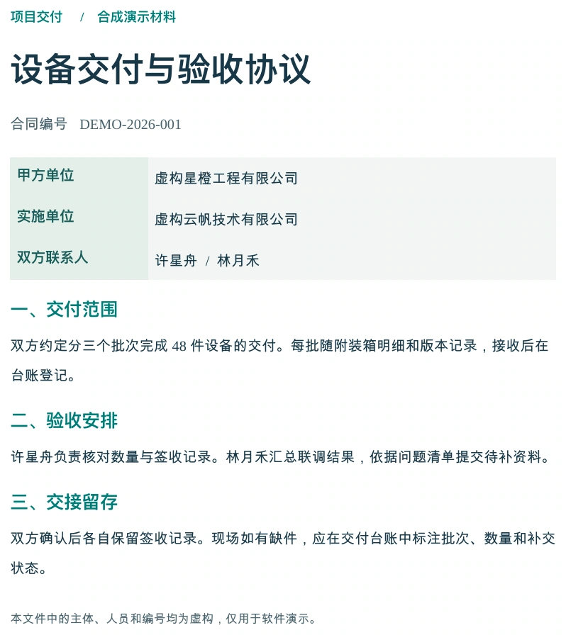
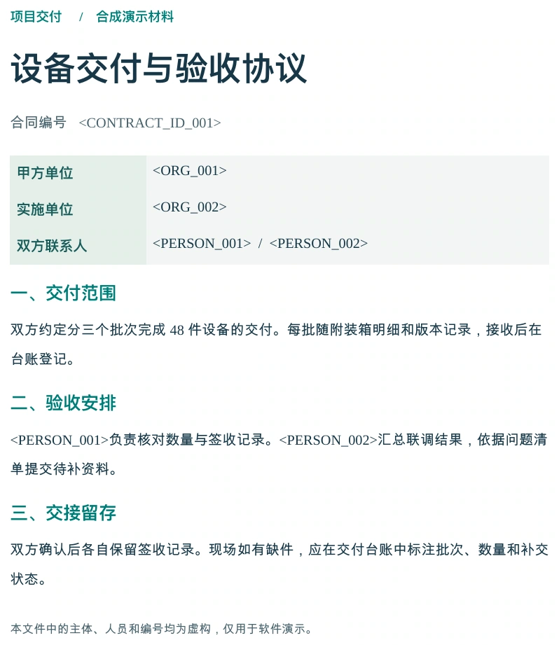
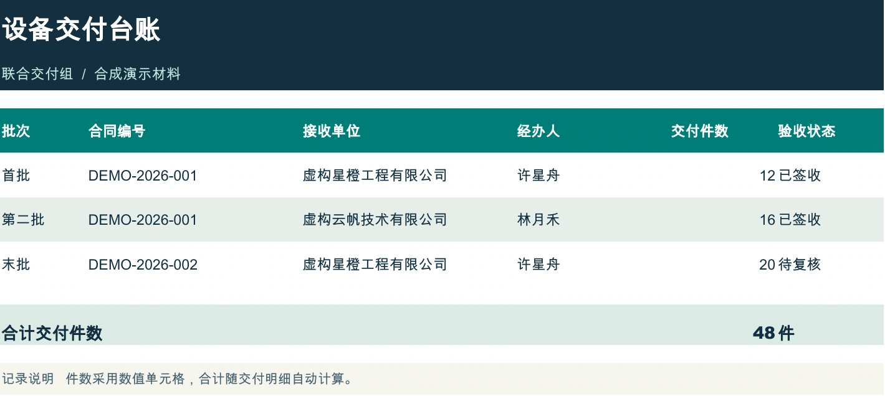
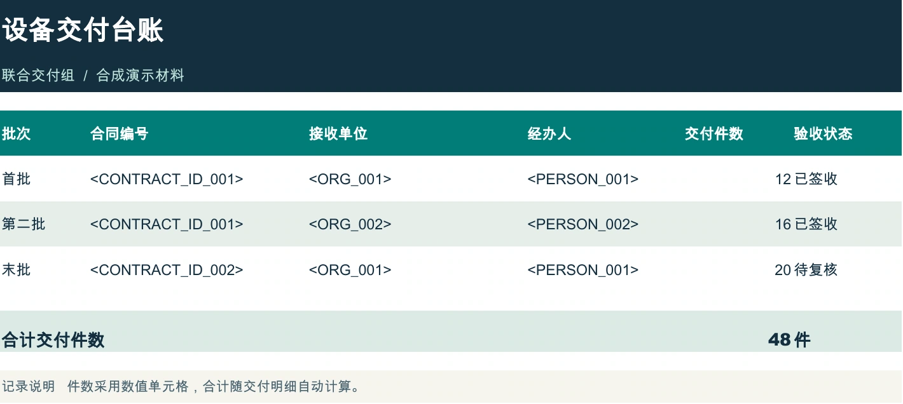
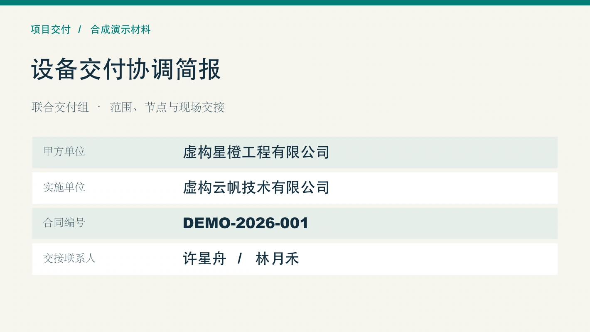
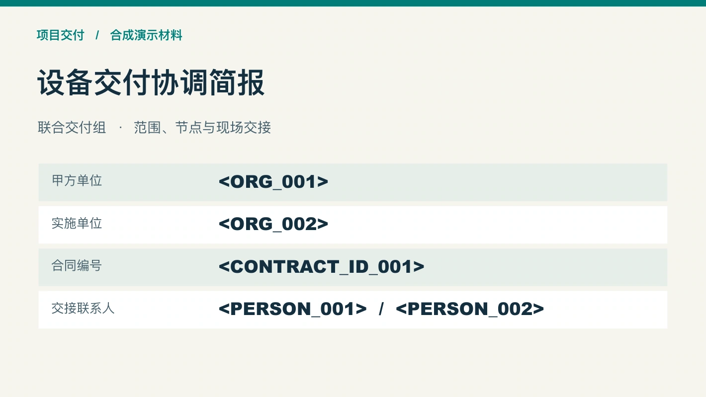

# Office 与剪贴板现场演示

[下载全部材料 ZIP](https://github.com/Doubixilin/tuomin-open-source/releases/download/v0.2.0/Tuomin-0.2.0-Demo.zip) · [打开 7 页演示课件](Tuomin-workflow-demo.pptx) · [剪贴板操作与界面实拍](../../docs/DESKTOP_GUIDE.md#剪贴板)

这套材料讲同一个设备交付项目。两家单位、两名联系人和合同编号都是虚构值。ZIP 还附有课件的 PDF 版，便于直接投屏。可以先放映课件，再打开下面的原件、脱敏件、回填件现场对照。所有脱敏件和回填件都由公开版工作台接口实际生成。

| 可以直接打开的样例 | 合成原件 | 脱敏件 | 回填件 | 现场核对 |
| --- | --- | --- | --- | --- |
| Word 验收协议 | [DOCX](original/service-agreement.docx) | [DOCX](redacted/service-agreement.docx) | [DOCX](refilled/service-agreement.docx) | 对照合同编号、表格中的双方和条款中再次出现的联系人，共替换 7 处。 |
| Excel 交付台账 | [XLSX](original/delivery-register.xlsx) | [XLSX](redacted/delivery-register.xlsx) | [XLSX](refilled/delivery-register.xlsx) | 对照三列身份信息，共替换 9 处。E5 到 E7 仍为 12、16、20，E9 的 `=SUM(E5:E7)` 仍得 48。 |
| PowerPoint 项目简报 | [PPTX](original/project-brief.pptx) | [PPTX](redacted/project-brief.pptx) | [PPTX](refilled/project-brief.pptx) | 查看首页与末页重复出现的主体、人员、合同编号，共替换 10 处。第二页的交付节点仍然可读。 |

## 文件打开后的实际效果

点击图片放大。以下是用 LibreOffice 打开对应文件后的渲染。Word 图裁去了页边空白，PPT 展示首页。字体和换行会随 Office 软件与本机字体变化。

| 合成原件 | 导出脱敏件 |
| --- | --- |
|  |  |
|  |  |
|  |  |

## 现场再做一遍

1. 完全退出已经打开的 Tuomin，然后以 `--demo` 启动。在 Mac 上可运行 `open -a "Tuomin Lite" --args --demo`，Windows 在解压目录运行 `.\Tuomin.exe --demo`，源码运行 `python packaging/launcher.py --demo`。演示会话使用隔离的临时数据及自带的合成词典。
2. 进入「文件脱敏」，选择「合成合同演示」与 `original` 中的一份文件，检查预览，再导出原格式脱敏文件。打开副本，查看身份信息是否已替换、业务内容是否可用。
3. 进入「文件回填」，选择本机**刚刚导出原格式副本的任务**，载入该副本并恢复。每次处理各自生成映射，演示包中的预制成品用于对照。可将自己的结果与 `refilled` 中的样例并排查看。
4. 演示剪贴板时，复制「虚构星橙工程有限公司由许星舟负责验收」。复制完成时剪贴板仍含原文。选择「脱敏剪贴板」，或按 macOS **Option+Command+D**、Windows **Ctrl+Alt+D**，成功后再手动粘贴给 AI。复制带占位符的回答，选择「回填剪贴板」，或按 macOS **Option+Command+R**、Windows **Ctrl+Alt+R**，随后把含原值的结果粘回本地文档。未知标记或并发改动导致阻断时，普通操作会保留当时的剪贴板内容。

本次样例使用公开 Lite 的规则、[合成词典](../synthetic-dictionary.json)和每个文件自己的本地任务。回填后逐项比对了合同正文与表格中的文字、工作表单元格及公式、三页幻灯片的文字。扫描件、图片里的字、未登记的新姓名，需要另行核对。图片和课件的读者无需运行 Tuomin 即可查看结果。
